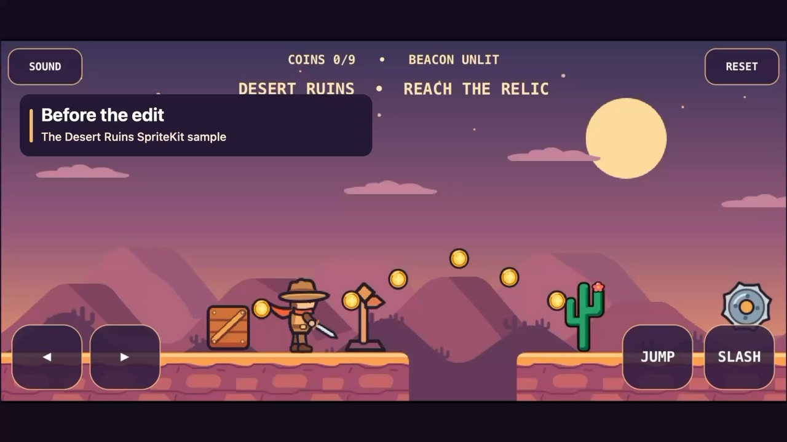

# Scroller2d

**Build SpriteKit levels visually.**

Scroller2d combines a Mac level editor with a Swift API for loading level data, constructing horizontal terrain, creating configured obstacles and enemies, and following characters with a camera.

[Run the sample](Samples/DesertRuins/README.md) · [Watch the demo](https://scroller2d.com/videos/Scroller2D%20Editor%20to%20Game.mp4) · [Read the tutorials](https://scroller2d.com/Articles)

## See an edit become gameplay

Move a collectible in LevelEditor, save the level, and see the change in the SpriteKit sample.

**[Watch the editor-to-game demo](https://scroller2d.com/videos/Scroller2D%20Editor%20to%20Game.mp4)**

## Tutorials

Start with a working example, then explore how Scroller2d fits into your game.

- **[Run and edit Desert Ruins](https://scroller2d.com/Articles/desert-ruins-quickstart)**\
  Run the iOS sample, move a collectible in LevelEditor, and see the change in SpriteKit.

- **[Load a SpriteKit level from a plist](https://scroller2d.com/Articles/load-spritekit-level-from-plist)**\
  Load level and catalog data, resolve overrides, and assemble configured scene objects.

- **[Switch between character animation states](https://scroller2d.com/Articles/spritekit-animation-states)**\
  Coordinate idle, running, jumping, and attack animations without restarting playback every frame.

- **[What Scroller2d handles in a SpriteKit game](https://scroller2d.com/Articles/what-scroller2d-handles)**\
  Understand what the editor and API provide and which responsibilities remain in your game.

[Browse all SpriteKit tutorials →](https://scroller2d.com/Articles)

## About Scroller2d

Are you looking for an easy to use SpriteKit helper that lowers anxiety and increases productivity?  Scroller2d allows you to quickly use helper objects, a visual editor, and defined configuration data to provide all the tools necessary unleash your inner creative.

Building a game is a time consuming and difficult task. You need to bring together many different elements such as visual assets, game play strategy, challenges, and above all the code to bring this all together. This is where Scroller2d attempts to help accelerate your ideas by providing a framework and visual editor to create levels in a data driven approach that allows you to modularize your game level core logic.

Every level has repeatable core principles: background, floor (horizontal scrolling), enemies, obstacles, collectibles, checkpoints, and artifacts, etc.

Using the data models only without the visual editor, classes, or object creators is free. You will never have to pay to organize your ideas and put them into action.

## Questions and feedback

Open an issue for integration questions, reproducible bugs, or helper requests:

- [Report a bug](https://github.com/coolmonkeyllc/Scroller2d/issues/new?template=bug-report.yml)
- [Ask an integration question](https://github.com/coolmonkeyllc/Scroller2d/issues/new?template=integration-question.yml)
- [Request a helper](https://github.com/coolmonkeyllc/Scroller2d/issues/new?template=helper-request.yml)

Include your Scroller2d version, target platform, and Xcode or LevelEditor version
when relevant. Issues are public: remove license keys and other private information
from code, logs, screenshots, and attachments before posting. For private account
or licensing questions, use the [contact page](https://scroller2d.com/Contact).

## Demo licensing

The Desert Ruins demo Swift code is MIT licensed. The Scroller2d API, LevelEditor,
and artwork have separate terms. See [component licensing](Samples/DesertRuins/LICENSING.md).
