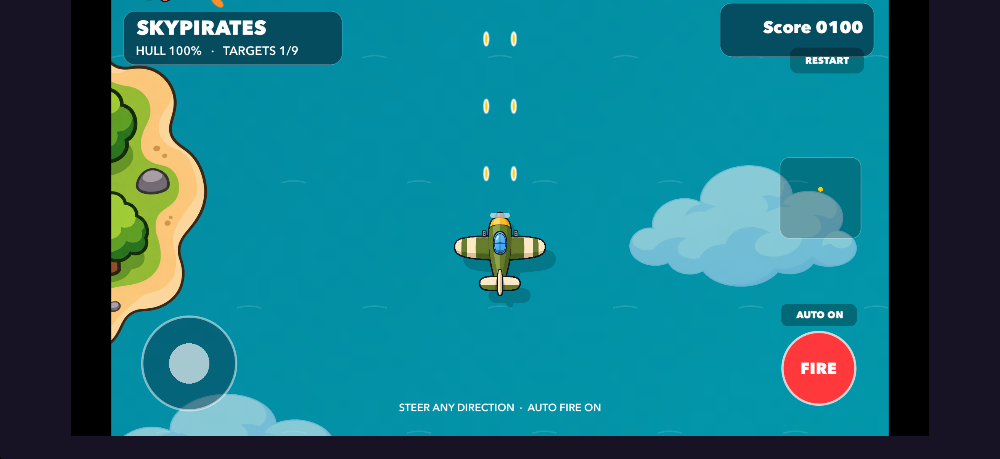

# Skypirates for iOS

A top-down, free-roaming propeller-plane game demonstrating Scroller2d camera follow
in all 2D directions. Fly across an ocean archipelago, shoot down six raiders, destroy
three patrol boats, and replay the mission. The rounded artwork follows the included
[visual concept](Artwork/skypirates-concept.png).



## Build and run

1. Keep this folder beside `Skypirates Workspace`, inside `Samples/Skypirates`. The API is shared from `Samples/DesertRuins/Scroller2d Api`.
2. Open `Skypirates.xcodeproj` using Xcode 27.2 or later.
3. Select the **Skypirates** scheme and an iPhone or iPad simulator, then Run.
4. For a physical device, choose your own signing team and bundle identifier.

The deployment target is iOS 26.6. The framework is referenced relatively as
`../../DesertRuins/Scroller2d Api/Scroller2d.xcframework`. No machine-specific framework path is needed.
If replacing an older API, use **Product → Clean Build Folder** before rebuilding.

## Controls

| Action | Touch | Keyboard |
| --- | --- | --- |
| Steer in any direction | Drag the left joystick | WASD or arrow keys |
| Fire | Automatic by default; hold FIRE for manual firing | Space |
| Toggle automatic firing | AUTO ON/OFF | F |
| Replay or restart | RESTART, or tap the result panel | R |

The aircraft keeps flying when steering is released, retaining its last heading.
Weapons fire along the nose; lead moving targets. Boats require five hits and aircraft
two. Collisions or hostile shots remove 20% hull with a brief protection interval.
Destroy all targets to win, or restart after losing the aircraft.

## How scrolling works

The ocean and islands have stable world coordinates. `CameraFollowHelper` follows
both axes with smoothing and heading-relative look-ahead. Camera motion makes world
objects move opposite to the plane's flight on screen, including diagonal flight.
Clouds use a separate camera-relative offset controlled by the background model's
`speed`, so the foreground moves at a different apparent rate. The camera stays
unrotated; the plane itself turns. Near the map boundary, the camera clamps and the
plane can move away from screen center. `LevelData.worldBounds` defines the playable
3,200 × 3,200 world; the scene's 960 × 540 design size defines the view and HUD.

## Scroller2d API responsibilities

| API | Used for |
| --- | --- |
| `Level`, `LevelSettings`, `ObstacleConfig`, `CharacterConfig`, `BackgroundImage`, and device properties | Editable placements, image names, sizes, layer speed, and the `both` scroll orientation |
| `LevelAssemblyHelper.Resources` | Loading existing level and catalog formats and resolving catalog/placement overrides |
| `CreateObstacleHelper` | Constructing islands, raiders, and boat nodes from resolved models |
| `SKSpriteNode2dBase` | Player and configured world sprites |
| `AppSharedSceneBase` and lifecycle delegates | Startup, updates, and camera updates after simulation |
| Contact delegate | Routing real SpriteKit projectile and aircraft contacts into gameplay |
| `CameraFollowHelper` | Both-axis following, smoothing, look-ahead, and bounds |
| `SKAction.manualAnimate` | Repeated propeller-frame playback |
| `SKAction.blink` | Reusable player damage feedback |

The demo supplies aircraft steering, enemy targeting, projectile creation, damage and
score rules, cloud placement, controls, and result/replay UI. It does not use the
horizontal-only `LevelAssemblyHelper.build` or `GroundConstructionHelper`; the camera
helper works independently of those terrain assumptions. Aircraft AI uses flight
steering rather than the platform-oriented enemy movement setup.

## Edit the level

Open the sibling **Skypirates Workspace** folder in LevelEditor, then open
`Levels/Skypirates.plist`. Move a boat, island, raider, or pilot start and save.
From this demo folder run:

```sh
./sync-level.sh "../Skypirates Workspace"
```

The script copies the level and catalogs and updates four image sets in
`Skypirates/LevelArt.xcassets`. It requires Python 3. The hero and red-tinted enemy
share the `hero_plane` image set; its canonical source is `Assets/Images/Characters`.
The workspace also includes a matching copy under Obstacles for editor preview.
The enemy tint and flight rules are game-specific. The fixed cloud distribution and
map bounds are defined in Swift. The demo is silent; it includes no music or sounds.

## Verification

Add `--verify-gameplay` under the scheme's **Run → Arguments Passed On Launch**
for a Debug build. The aircraft flies a square using the normal steering and firing
paths. Console output reports movement, camera following, real projectile hits, and
received damage as `SKYPIRATES_SMOKE_PASSED` or `FAILED`. The check then explicitly
opens the victory panel and exercises replay and pause/resume, reporting
`SKYPIRATES_REPLAY_PASSED` or `FAILED`. This result-panel check does not claim the
autopilot defeated every target. Remove the argument to play normally.

## Licensing and artwork

The demo Swift code is MIT licensed; see [LICENSE](LICENSE). That grant excludes the
Scroller2d binary, LevelEditor, artwork, and other repository content. Scroller2d API
and LevelEditor terms remain separate. The API's data models are free to use; its
scene classes and runtime helpers require an API license. To clear the runtime
license notice, generate your own `api_license.plist` in licensed LevelEditor and
add it to the app target's **Copy Bundle Resources** at the bundle root. Personal
license files should not be committed. See [product licensing](https://scroller2d.com/Download#licensing).

The concept and sprite artwork were AI-generated specifically for Skypirates using
OpenAI's built-in image-generation tool. No third-party asset pack was imported.
See [ARTWORK.md](ARTWORK.md) for prompts and provenance. Do not describe the artwork
as hand-drawn or guarantee that AI-generated images are unique or copyright-free.
